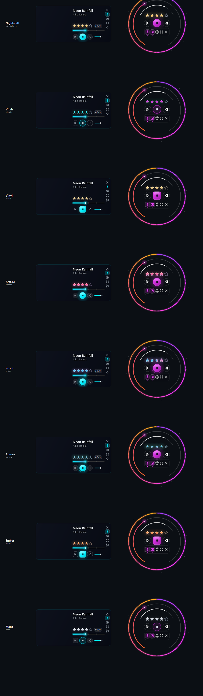

<div align="center">

# ⚡ Audio Player Pro (v2)
### *Next-Gen Desktop Music Engine & Cyberpunk Floating HUD*

[](https://python.org)
[](https://riverbankcomputing.com/software/pyqt/)
[](https://numpy.org)
[](https://github.com/c0pperfi3ld/music-player)
[](LICENSE)

<br/>

<p align="center">
  <b>An audiophile-grade desktop music player marrying vectorized 60 FPS real-time DSP spectrum visualizations with an ultra-sleek, interactive floating mini-player HUD.</b>
</p>

[✨ Interface Showcase](#-interface-showcase) • [⚡ Core Highlights](#-core-highlights) • [🔮 The Mini-Player HUD](#-the-mini-player-hud) • [🌌 Visualizer Engines](#-visualizer-suite) • [🚀 Quickstart](#-getting-started) • [⌨️ Hotkeys](#-keyboard-shortcuts)

<br/>

</div>

---

## ✨ Interface Showcase

<div align="center">

### 🌌 Circular HUD (Dial Mode) & Card View

| ⭕ Cyberpunk Radial Dial HUD | 🎴 Compact Glass Card Mode |
| :---: | :---: |
|  |  |
| *Real-time reactive audio spoke spectrum, dual progress & volume rings, interactive 5-star rating, and docked glass utility capsule.* | *Bilinear waveform scrubber, track rank badge, glowing transport deck, and edge-docked utility controls.* |

<br/>

### 🎨 Five Handcrafted Visual Themes & Skins



*Real dynamic shader-like themes: **Nightshift** (warm amber), **Vitals** (cyan/emerald), **Vinyl** (gold/obsidian), **Arcade** (neon pink), and **Prism** (orbital aurora).*

</div>

---

## ⚡ Core Highlights

<table width="100%">
<tr>
<td width="50%" valign="top">

### 🎧 Audiophile Playback Engine
* **Universal Format Support**: Lossless FLAC, WAV, ALAC, AIFF alongside standard MP3, M4A, OGG, OPUS, AAC.
* **Granular Pitch & Tempo**: Independent speed scale from `0.25x` to `2.0x` with formant-preserving pitch correction.
* **Musician A-B Looping**: Instant punch-in/out loop markers with live colored waveform zone rendering.
* **Microsecond Seek Engine**: Instant scrub response with smooth crossfade track transition protection.

</td>
<td width="50%" valign="top">

### 🔮 Futuristic Floating Gadget HUD
* **Dual Morphing Layouts**: Instant hotkey switch between clean horizontal **Card View** and radial **Dial HUD**.
* **Centered Symmetry Architecture**: 3-tier balanced control layout (5-Star Rating, Main Playback, and Glass Capsule Dock).
* **Always-On-Top Pinning**: Unobtrusive companion window with smooth window border edge-snapping.
* **Hardware-Accelerated Glow**: Custom vector `QPainterPath` drawing with zero-flicker double-buffered rendering.

</td>
</tr>
</table>

---

## 🔮 The Mini-Player HUD

The mini-gadget (`Ctrl + G`) transforms the player into an ambient, space-efficient desktop companion:

```
┌─────────────────────────────────────────────────────────────┐
│                      RADIAL DIAL HUD                        │
├─────────────────────────────────────────────────────────────┤
│  [Top Row]    ✦ ✦ ✦ ✦ ✧   Interactive 5-Star Track Rating   │
│  [Center]     ⏮  ▶❚❚  ⏭   True-Centered Fluid Transport     │
│  [Bottom]     [ 📌 🗖 ⚙ ⛶ ✕ ] Glass Capsule Utility Dock    │
│  [Perimeter]  360° FFT Audio Motes & Reactive Spectrum Ring  │
└─────────────────────────────────────────────────────────────┘
```

* **Revamped Utility Dock**:
  - **Pin** (`📌`): Toggle Always-on-Top desktop priority.
  - **Pane** (`🗖`): Toggle mini audio-spectrum visualizer display.
  - **Settings** (`⚙`): Direct 6-tooth mechanical cog icon triggering quick settings.
  - **Size** (`⛶`): Seamless cycle through Small (`300px`), Medium (`372px`), and Large (`440px`).
  - **Close** (`✕`): Quick dock dismissal.

---

## 🌌 Visualizer Suite

Real-time audio decomposition powered by NumPy vectorized Fast Fourier Transforms (`rfft`):

```
┌──────────────────────┬────────────────────────────────────────────────────────┐
│ Visualizer Mode      │ Visual Experience & Dynamics                           │
├──────────────────────┼────────────────────────────────────────────────────────┤
│ 🌠 Starburst Galaxy   │ Orbital stellar particle field reacting to bass peaks  │
│ ✨ Nebula Vortex      │ Swirling interstellar cosmic vortex with spectral motes│
│ 🌊 Sound Aurora      │ Multilayer luminous gradient waves across 64 bands     │
│ ⚡ Stereo Scope      │ Dual-channel phase correlation vector oscilloscope     │
│ 🌐 Retro Synth Grid  │ 80s synthwave perspective terrain reacting to kick drum│
│ 💧 Waterfall Cascade │ Cascading spectral waterfall tracking frequency drift  │
└──────────────────────┴────────────────────────────────────────────────────────┘
```

---

## 🚀 Getting Started

### 1. Prerequisites
Ensure you have **Python 3.10 or higher**:
```bash
python --version
```

### 2. Clone the Repository
```bash
git clone https://github.com/c0pperfi3ld/music-player.git
cd music-player
```

### 3. Install Dependencies
```bash
pip install -r requirements.txt
```

### 4. Launch the Player
```bash
python audio_player_pro_v2.py
```

---

## ⌨️ Keyboard Shortcuts

| Shortcut | Description |
| :--- | :--- |
| <kbd>Space</kbd> | Toggle Play / Pause |
| <kbd>Ctrl</kbd> + <kbd>→</kbd> / <kbd>Ctrl</kbd> + <kbd>←</kbd> | Next / Previous Track |
| <kbd>→</kbd> / <kbd>←</kbd> | Relative seek (±5 seconds) |
| <kbd>Shift</kbd> + <kbd>→</kbd> / <kbd>Shift</kbd> + <kbd>←</kbd> | Fine seek (±1 second) |
| <kbd>↑</kbd> / <kbd>↓</kbd> | Volume Up / Down |
| <kbd>M</kbd> | Mute / Unmute audio |
| <kbd>Ctrl</kbd> + <kbd>G</kbd> | Toggle Mini-Player Gadget HUD |
| <kbd>[</kbd> / <kbd>]</kbd> | Set Loop Point A / Set Loop Point B |
| <kbd>\</kbd> | Clear Active A-B Loop |
| <kbd>1</kbd> – <kbd>5</kbd> | Rate track (1 to 5 Stars) |
| <kbd>Esc</kbd> | Dismiss Gadget or Fullscreen |

---

## 🏗️ Architecture & Stack

```
music-player/
├── audio_player_pro_v2.py    # Core application (PyQt6 window, DSP engine, Gadget HUD)
├── design/                   # Headless rendering & geometry design harness
│   ├── gadget_study.py       # Standalone canvas snapshot verification runner
│   └── circle_design.py      # Polar coordinate spline & circular arc math
├── requirements.txt          # Python dependencies
└── .gitignore                # Privacy contract: excludes all audio, tokens, & user data
```

* **GUI & Graphics**: [PyQt6](https://www.riverbankcomputing.com/software/pyqt/) with pure hardware-accelerated `QPainter` drawing pipelines.
* **DSP & FFT**: Vectorized NumPy linear algebra with logarithmic octave-band aggregation.
* **Audio Playback**: `QMediaPlayer` / `QAudioOutput` with high-resolution frame-accurate timeline sync.
* **Tagging & Metadata**: [Mutagen](https://mutagen.readthedocs.io/) stream parser for lossless and lossy codecs.

---

## 🛡️ Privacy & Local-First Philosophy
* **Zero Telemetry**: No trackers, analytics, or external phone-home requests.
* **Local Identity**: All cache files, playlists, and track ratings remain local on your machine.
* **Clean Repo Policy**: Audio files, credentials, and user playback history are strictly excluded by `.gitignore`.

---

<div align="center">

Distributed under the **MIT License**. Crafted with precision for high-performance audio playback.

</div>
