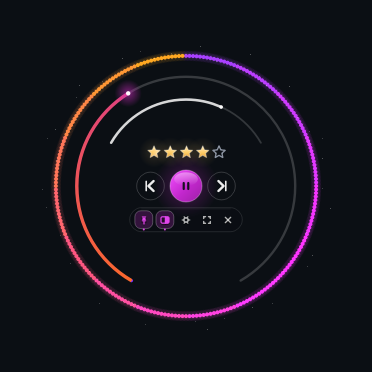
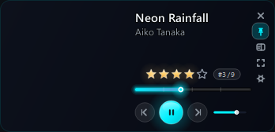

# 🎵 Audio Player Pro (v2)

<div align="center">


<p align="center">
  <b>A high-performance desktop music player featuring real-time DSP spectrum visualizers, intelligent track profiling, A-B looping, and a futuristic floating mini-gadget HUD.</b>
</p>

[Key Features](#-key-features) • [Gadget HUD](#-mini-player-gadget-hud) • [Visualizers](#-dsp-audio-visualizers) • [Installation](#-quick-start) • [Shortcuts](#-keyboard-shortcuts)

</div>

---

## 🌟 Visual Showcase

<div align="center">

### 🌌 Circular HUD (Dial Mode) & Card View

| ⭕ Dial Mode (Symmetrical HUD) | 🎴 Card Mode (Compact Desktop View) |
| :---: | :---: |
|  |  |
| *Real-time spectrum ring, 5-star rating, centered playback controls, and glass utility dock* | *Waveform progress scrubber, live rank chip, and floating transport controls* |

</div>

---

## ⚡ Key Features

### 🎧 Core Playback Engine
* **Universal Format Support**: Lossless FLAC, WAV, ALAC, AIFF, plus MP3, M4A, OGG, OPUS, and AAC.
* **Precise Scrubbing & Seeking**: Smooth waveform scrubbing, millisecond-accurate seek bar, and relative jump controls (`←` / `→`).
* **Variable Pitch & Speed**: Granular speed adjustment (0.25x – 2.0x) with high-fidelity pitch compensation.
* **A-B Practice Looping**: Pinpoint start (A) and end (B) loop points with visual range indicators for musicians and transcription.
* **Gapless Transitions & Shuffle**: Smart playlist queue management, track search filtering, and random shuffle.

### 🔮 Mini-Player Gadget HUD (Card & Dial)
* **Dual Form Factor**:
  * **Card Mode**: Elegant rectangular desk companion with full title, artist, seek track, volume slider, and track rank `#X/Y`.
  * **Dial HUD Mode**: Cyberpunk-style circular widget featuring a glowing radial spectrum, smooth seek arc, and volume ring.
* **Centered 3-Tier Architecture**:
  * **Tier 1 (Top)**: Interactive 5-star rating system with real-time glow and specular shine.
  * **Tier 2 (Center)**: True-centered transport controls (Previous `|<`, Main Play/Pause, and Next `>|`).
  * **Tier 3 (Bottom)**: Refined glass utility dock (Always-on-Top Pin, Pane Selector, Settings Cogwheel, S/M/L Size Cycle, and Close).
* **Always-on-Top & Edge Snapping**: Floats above other windows and softly snaps to display borders.

### 📊 Real-Time DSP Audio Visualizers
Powered by vectorized NumPy FFT transforms for fluid 60 FPS rendering:
* **Audio Starburst Galaxy**: Dynamic orbital star particle field reacting to frequency bands.
* **Nebula Vortex**: Swirling cosmic vortex with reactive spectral motes.
* **Sound Aurora**: Flowing multi-layered glowing frequency waves.
* **Stereo Scope & Waterfall**: Dual-channel stereo visualizer and waterfall frequency waterfall.
* **Retro Synth Grid**: 80s synthwave perspective wireframe floor with audio-reactive terrain.

---

## 🚀 Quick Start

### 1. Prerequisites
Ensure you have **Python 3.10+** installed:
```bash
python --version
```

### 2. Clone the Repository
```bash
git clone https://github.com/c0pperfi3ld/music-player.git
cd music-player
```

### 3. Install Dependencies
```bash
pip install -r requirements.txt
```
*(Dependencies: `PyQt6`, `numpy`, `mutagen`, `yt-dlp`)*

### 4. Run the Player
```bash
python audio_player_pro_v2.py
```

---

## ⌨️ Keyboard Shortcuts

| Shortcut | Action |
| :--- | :--- |
| <kbd>Space</kbd> | Toggle Play / Pause |
| <kbd>Ctrl</kbd> + <kbd>→</kbd> / <kbd>Ctrl</kbd> + <kbd>←</kbd> | Next / Previous Track |
| <kbd>→</kbd> / <kbd>←</kbd> | Seek forward / backward (5 seconds) |
| <kbd>↑</kbd> / <kbd>↓</kbd> | Volume Up / Down (2%) |
| <kbd>M</kbd> | Mute / Unmute audio |
| <kbd>Ctrl</kbd> + <kbd>G</kbd> | Toggle Mini-Player Gadget mode |
| <kbd>[</kbd> / <kbd>]</kbd> | Set Loop Point A / Set Loop Point B |
| <kbd>\</kbd> | Clear A-B Loop |
| <kbd>1</kbd> – <kbd>5</kbd> | Rate track (1 to 5 Stars) |
| <kbd>Esc</kbd> | Exit Gadget / Fullscreen Mode |

---

## 🛠️ Architecture & Tech Stack

```
music-player/
├── audio_player_pro_v2.py    # Main application (PyQt6 window, audio engine, Gadget HUD)
├── design/                   # Visual design verification & render harness
│   ├── gadget_study.py       # Headless study harness rendering pixel-exact UI snapshots
│   └── circle_design.py      # Mathematical spline & circular geometry computations
├── requirements.txt          # Python runtime dependencies
└── .gitignore                # Strict privacy rules (excludes audio files, tokens, and caches)
```

* **GUI Framework**: [PyQt6](https://www.riverbankcomputing.com/software/pyqt/) with custom hardware-accelerated `QPainter` drawing pipelines.
* **Audio Backend**: `QMediaPlayer` / `QAudioOutput` with high-resolution position timing.
* **DSP Processing**: Fast Fourier Transforms (`np.fft.rfft`) with logarithmic frequency band grouping.
* **Metadata Extraction**: [Mutagen](https://mutagen.readthedocs.io/) for ID3, Vorbis, FLAC, and MP4 tag resolution.

---

## 📄 License

This project is licensed under the MIT License - feel free to customize and enjoy your music!
