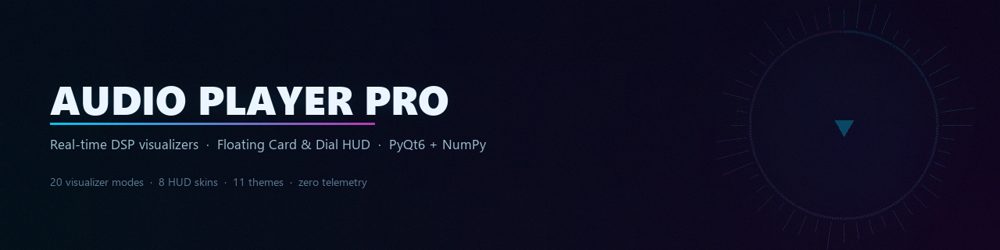
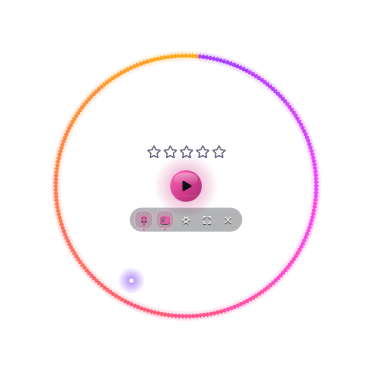

<div align="center">



<br/><br/>

<a href="https://github.com/c0pperfi3ld/music-player">
  
</a>

<br/>

[](https://python.org)
[](https://riverbankcomputing.com/software/pyqt/)
[](https://numpy.org)
[](LICENSE)
[](#-privacy)

<br/>

**A studio-grade desktop music player with a real-time vector visualizer engine<br/>and a floating HUD that reshapes itself into a card or a dial.**

<br/>

[Appearance Modes](#-appearance-modes) · [HUD](#-floating-hud) · [Visualizers](#-visualizers) · [Skins](#-skins) · [Features](#-features) · [Quickstart](#-quickstart) · [Keys](#%EF%B8%8F-keyboard--mouse) · [Architecture](#-architecture)

</div>

<br/>

---

<br/>

## 🎛️ Appearance Modes

One segmented switch in the header — or <kbd>Ctrl</kbd>+<kbd>1</kbd> / <kbd>2</kbd> / <kbd>3</kbd> — flips the entire app between three surfaces. No tray icon dance, no lost playlist state.

<br/>

<div align="center">
<table>
<tr>
<td align="center" width="50%">

### ▬ Card HUD


A compact 348 × 168 desk companion with title, artist, waveform scrubber, star rating, transport controls and a volume rail.

</td>
<td align="center" width="50%">

### ◉ Dial HUD



A 372 × 372 circular HUD with 360° FFT spokes, glowing seek and volume rings, star rating row and a glass utility dock.

</td>
</tr>
</table>
</div>

<div align="center">

<br/>
<sub>Custom-painted segmented pill, accent-tinted per theme</sub>
</div>

<br/>

**▣ Full Window** — the main workstation surface. Playlist table with rating, title, artist, duration, format, quality and folder origin. Spectrum visualizer pane. Waveform overview with A-B loop markers. Transport deck. 7-band EQ and remix rack. YouTube downloader.

> All screenshots are rendered offscreen by [`design/mode_probe.py`](design/mode_probe.py) in an empty state — no personal library data is ever captured into this repository.

<details>
<summary><b>Every route in and out of the HUD keeps the switch in sync</b></summary>

<br/>

| Action | Result |
| :-- | :-- |
| Click a segment in the header | → full / card / dial |
| <kbd>Ctrl</kbd>+<kbd>1</kbd> · <kbd>2</kbd> · <kbd>3</kbd> (works inside the HUD too) | → full / card / dial |
| Double-click the dial | → flips card ↔ dial |
| Right-click HUD → **Appearance mode** | → full / card / dial |
| Minimise the main window | → card HUD |
| HUD ✕ or <kbd>Esc</kbd> | → full window |

</details>

<br/>

---

<br/>

## 🔮 Floating HUD

Same widget, two layouts. The dial stacks three centred rows inside one circle; the card lays them in a strip.

```
        ◉ DIAL HUD                          ▬ CARD HUD
 ┌─────────────────────────┐        ┌───────────────────────────┐
 │   〰 360° FFT spokes      │        │ ┌───┐  Title              │
 │                           │        │ │art│  Artist             │
 │     ★ ★ ★ ★ ☆  rating     │        │ └───┘  ▁▂▃▅▇▅▃▂▁ scrub   │
 │     ⏮  ▶  ⏭   transport   │        │  ★★★★☆  #3/9              │
 │   [📌 ▭ ⚙ ⤢ ✕] dock       │        │ ⏮ ▶ ⏭  ▬▬▬▬ vol  📌▭⚙⤢✕  │
 └─────────────────────────┘        └───────────────────────────┘
```

<table>
<tr>
<td>📌</td><td><b>Always-on-top</b> — optional pin keeps the HUD above every window</td>
</tr>
<tr>
<td>🪟</td><td><b>Three capture modes</b> — opaque card, real glass transparency, or fully see-through</td>
</tr>
<tr>
<td>🧲</td><td><b>Edge snapping</b> — the HUD snaps to screen edges with configurable sensitivity</td>
</tr>
<tr>
<td>🎨</td><td><b>8 skins</b> — each with its own star geometry, plate style, key shape and glow</td>
</tr>
</table>

<br/>

---

<br/>

## 🌌 Visualizers

**20 render modes** driven by vectorised NumPy FFT — log-spaced band edges, per-band attack/decay envelopes, peak hold — painted as a single vector pass per frame at 60 FPS.

<div align="center">
<table>
<tr>
<td>📊 Spectrum Bars</td>
<td>🌊 Liquid Wave</td>
<td>🌀 Radial Halo</td>
<td>✨ Audio Nebula</td>
</tr>
<tr>
<td>🪞 Dual Mirror Wave</td>
<td>💫 Circular Spectrum</td>
<td>🧬 Dual DNA Helix</td>
<td>🌌 Neon Plasma Grid</td>
</tr>
<tr>
<td>⚡ Neon Oscilloscope</td>
<td>🚀 Cyber Vortex Tunnel</td>
<td>🪐 Holographic Rings</td>
<td>⚡ Concert Laser Show</td>
</tr>
<tr>
<td>🔮 Quantum Wave Field</td>
<td>⬡ Cybernetic Hex Hive</td>
<td>🌊 Spectral Waterfall</td>
<td>🎯 Lissajous Phase</td>
</tr>
<tr>
<td>🌌 Borealis Aurora</td>
<td>🌆 80s Synth Horizon</td>
<td>🌠 Starburst Galaxy</td>
<td>💠 Fractal Kaleidoscope</td>
</tr>
</table>
</div>

The HUD hosts a 6-mode subset (`bars` · `wave` · `radial` · `mirror_wave` · `circular_bars` · `sound_aurora`) optimised for its 348–372 px viewport.

<br/>

---

<br/>

## 🎨 Skins

**8 skins** — each owns its star geometry, plate style, key shape and colour treatment. Switch live from the HUD context menu or the settings window.

<div align="center">


<br/>

**Nightshift** · **Vitals** · **Vinyl** · **Arcade** · **Prism** · **Aurora** · **Ember** · **Mono**
</div>

<br/>

The main window ships **11 themes**: Midnight Cyber · Synthwave 80s · Emerald Matrix · Crimson Nebula · Tokyo Violet · Solar Flare · Frost Aurora · Dark Pro · Ocean Deep · Cyber Amber · Minimal Studio.

<br/>

---

<br/>

## ⚡ Features

<table>
<tr>
<td width="50%" valign="top">

### 🎧 Playback
- Lossless **FLAC · WAV · ALAC · AIFF** plus MP3 · M4A · OGG · OPUS · AAC
- Shuffle, repeat (off / all / one), instant track switching
- Speed **0.25× – 2.50×** in 0.01 steps
- Full metadata display via Mutagen with disk cache

</td>
<td width="50%" valign="top">

### 🎚️ Remix Rack (DSP / FX)
- **Pitch** ±12 semitones, independent of tempo
- **Tempo** · **Reverb** · **Echo / Delay** · **Stereo Width**
- **Bass** and **Treble** shelves, 7-band parametric EQ
- Reset · bypass · render the entire chain

</td>
</tr>
<tr>
<td width="50%" valign="top">

### 🔁 A-B Looping
- Set an **A** point and a **B** point anywhere on the timeline
- The loop re-asserts itself across seek and track-load events
- The loop zone draws directly onto the waveform overview

</td>
<td width="50%" valign="top">

### ⭐ Library & Ratings
- Per-song profiles: rating, volume, speed, loop points, EQ preset
- 5-star rating with a live `#rank/total` chip in the HUD
- Sort, filter, drag-reorder, move to top / bottom
- Multi-folder scan + YouTube downloader (`yt-dlp`)

</td>
</tr>
</table>

<br/>

---

<br/>

## 🚀 Quickstart

```bash
# clone
git clone https://github.com/c0pperfi3ld/music-player.git
cd music-player

# install dependencies
pip install -r requirements.txt        # PyQt6, numpy, mutagen, yt-dlp

# run
python audio_player_pro_v2.py
```

> **Python 3.10+** required. First launch scans `~/Music` and `~/Music/AudioPlayerDownloads`.

<br/>

---

<br/>

## ⌨️ Keyboard & Mouse

| Input | Action |
| :-- | :-- |
| <kbd>Ctrl</kbd>+<kbd>1</kbd> / <kbd>2</kbd> / <kbd>3</kbd> | Full Window / Card HUD / Dial HUD |
| <kbd>Space</kbd> | Play / Pause |
| <kbd>←</kbd> / <kbd>→</kbd> | Seek ±5 s |
| <kbd>Esc</kbd> | Leave HUD → Full Window |
| <kbd>Alt</kbd>/<kbd>Ctrl</kbd> + <kbd>↑</kbd>/<kbd>↓</kbd> | Move selected track in playlist |
| Double-click dial | Flip Card ↔ Dial |
| Right-click HUD | Appearance, skin, size, background, visualizer, border |

<br/>

---

<br/>

## 🏗️ Architecture

```
music-player/
├── audio_player_pro_v2.py       # monolith — window, DSP, visualizers, HUD
├── design/
│   ├── gadget_study.py          # headless render harness for the HUD
│   ├── mode_probe.py            # drives all 3 modes, captures screenshots
│   └── circle_design.py         # polar / arc geometry helpers
├── assets/
│   └── banner.png               # README hero banner
├── requirements.txt
├── LICENSE
└── .gitignore                   # blocks audio, credentials, caches
```

| Layer | Stack |
| :-- | :-- |
| **UI & painting** | PyQt6 · custom `QPainter` / `QPainterPath` vector rendering · spring-animated widgets |
| **Audio** | `QMediaPlayer` + `QAudioOutput` with frame-accurate position sync |
| **DSP** | NumPy `rfft` · log-spaced band aggregation · per-band envelope followers |
| **Metadata** | Mutagen (ID3 / Vorbis / FLAC / MP4) with a JSON disk cache |
| **Downloads** | `yt-dlp` with duplicate detection and format selection |

<br/>

---

<br/>

## 🛡️ Privacy

- **Zero telemetry** — no analytics, no tracking, no accounts, no phone-home.
- **Local data only** — library, ratings, profiles, waveform cache and settings stay in your own files.
- **Clean repo** — `.gitignore` blocks every audio format, credentials, tokens, cookies and caches so nothing personal can be committed by accident.

<br/>

---

<div align="center">

**MIT Licensed** · Built with PyQt6 + NumPy

If this was useful, a ⭐ on the repo means a lot.

</div>
